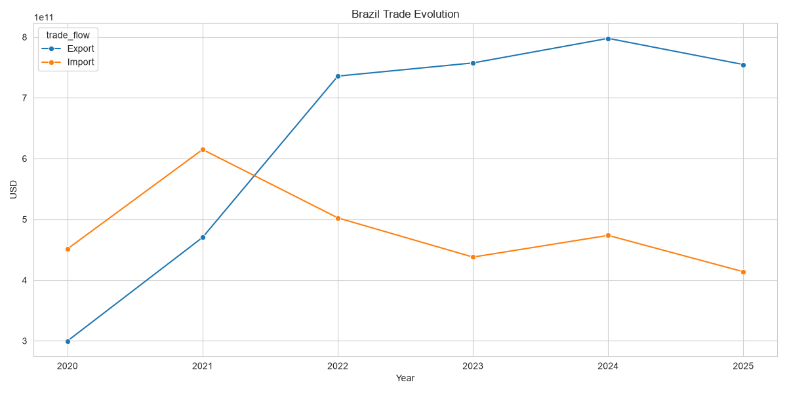
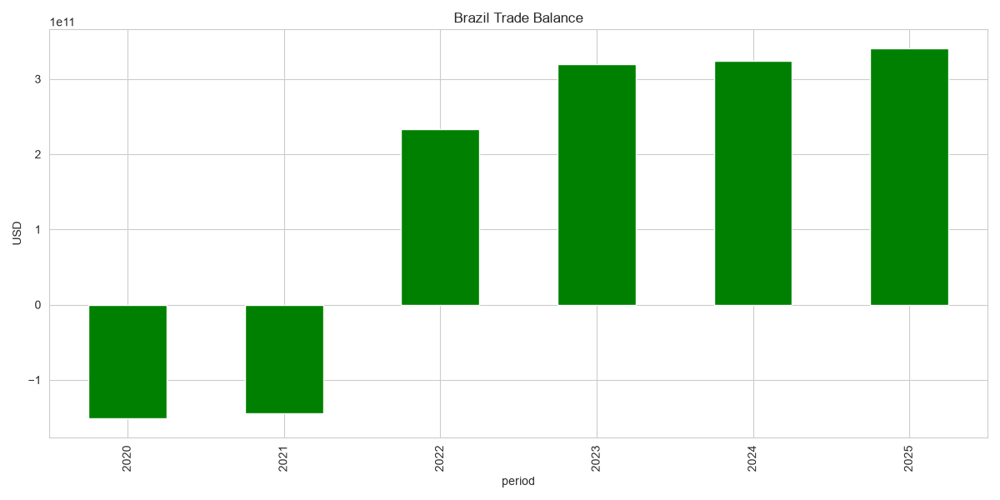
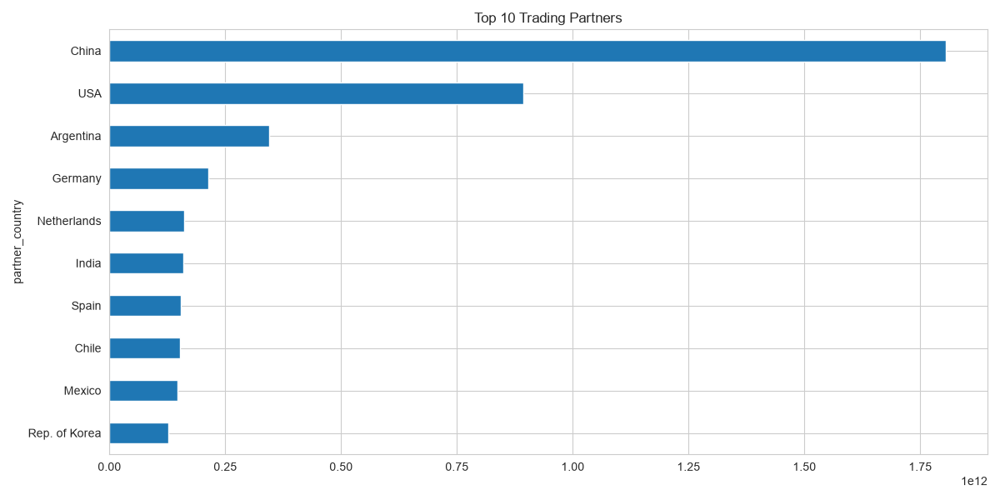

# 🇧🇷 Brazil Trade Analytics (2020-2025)

An end-to-end data analytics project analyzing Brazil's international trade using UN Comtrade data from 2020 to 2025.

## 📌 Project Overview

This project explores Brazil's import and export activities through an automated data pipeline, data processing workflow, interactive visualizations, and a Streamlit dashboard.

The goal is to identify major trade trends, top trading partners, leading imported products, and leading exported products.

## 🚀 Features

- Data extraction from UN Comtrade
- Data cleaning and transformation
- Exploratory Trade Analysis
- Interactive Plotly Visualizations
- Streamlit Dashboard
- Dynamic filtering by:
  - Year
  - Trading Partner
  - Product (HS6 Code + Description)

## 🛠️ Technologies Used

### Data Processing
- Python
- Pandas

### Data Visualization
- Plotly

### Dashboard Development
- Streamlit

### Version Control
- Git
- GitHub

## 📂 Project Structure

```text
maritime-trade-analytics/
│
├── app.py
├── README.md
├── requirements.txt
│
├── config/
│   └── config.py
│
├── data/
│   ├── raw/
│   └── processed/
│
├── src/
│   ├── load.py
│   ├── analysis.py
│   └── visualization.py
│
├── reports/
│   └── figures/
│
└── screenshots/
    ├── trade_evolution.png
    ├── trade_balance.png
    └── top_partners.png
```

## 📊 Dashboard KPIs

The dashboard provides:

- Total Exports
- Total Imports
- Trade Balance
- Number of Trading Partners

## 📈 Dashboard Visualizations

### Trade Evolution



### Trade Balance



### Top Trading Partners



## 🎛️ Interactive Filters

Users can explore the data using:

- Year Filter
- Trading Partner Filter
- Product Filter (HS6 Code + Product Description)

## 📦 Dataset Information

Source:

- UN Comtrade Database

Main fields used:

- Year
- Reporting Country
- Partner Country
- Trade Flow
- Product Code (HS6)
- Product Description
- Trade Value (USD)
- Net Weight (KG)

## 🔍 Key Insights

- Brazil maintains strong trade relationships with major global economies.
- Trade values experienced significant changes between 2020 and 2025.
- Petroleum products represent a significant share of imports.
- Product-level analysis highlights Brazil's most strategic traded commodities.
- Trading partner analysis reveals Brazil's dependence on key international markets.

## ▶️ Installation

Clone the repository:

```bash
git clone https://github.com/YOUR_USERNAME/maritime-trade-analytics.git
```

Move into the project folder:

```bash
cd maritime-trade-analytics
```

Install dependencies:

```bash
pip install -r requirements.txt
```

Run the Streamlit dashboard:

```bash
streamlit run app.py
```

## 🎯 Future Improvements

- Trade forecasting models
- Country-to-country comparison dashboard
- Automated data refresh pipeline
- Streamlit Cloud deployment
- Advanced trade intelligence indicators

## 👨‍💻 Author

Alpha Diallo

Data Analyst | Aspiring Data Engineer

---